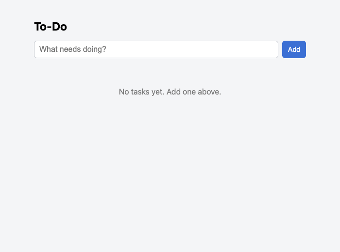
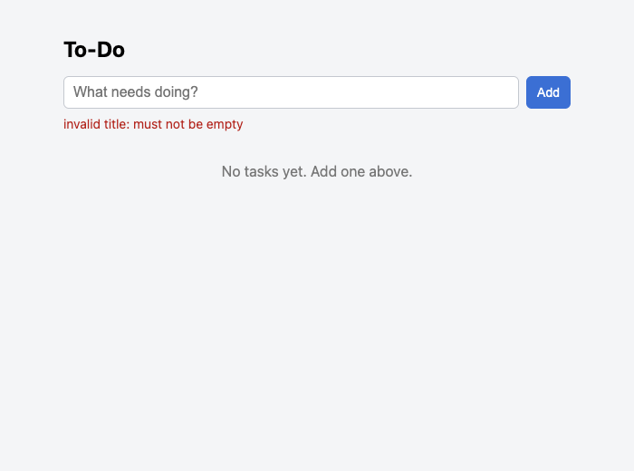
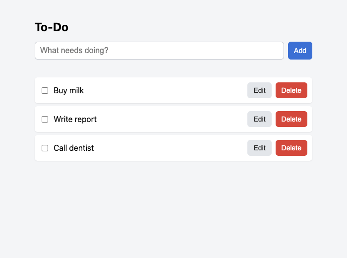
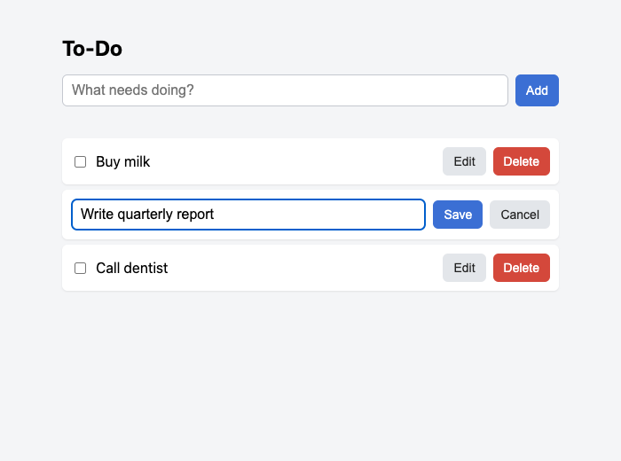
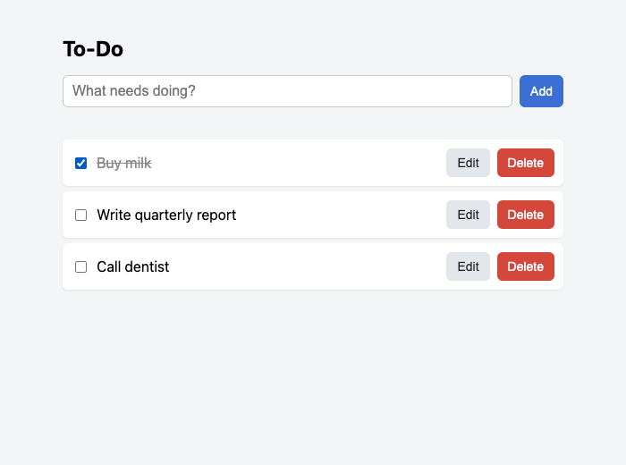
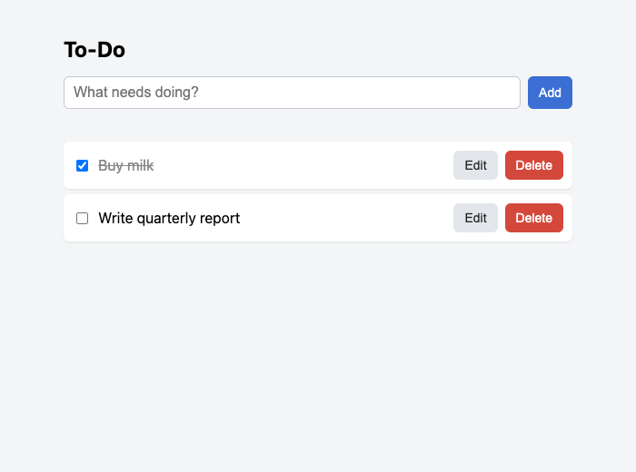

# To-Do

A small single-user to-do list web app that runs locally. Go backend, SQLite storage, one embedded HTML page (plain HTML/CSS/vanilla JS, no build step).

Design, scope and test plan: [docs/todo-app.md](docs/todo-app.md).

## Requirements

- Go 1.22. The Makefile expects it at `~/sdk/go1.22.12` (it sets `GOROOT` explicitly so an older Go in your shell cannot break the build). Elsewhere: `make run GOROOT=/path/to/go`.
- No other tools. SQLite is a pure-Go driver (`modernc.org/sqlite`), no cgo.

## Run

```
make run
```

Open <http://127.0.0.1:8080>. Stop with Ctrl+C.

Or build a binary and pass flags:

```
make build
./bin/todo -addr 127.0.0.1:9000 -db /path/to/todo.db
```

| Flag | Default | Meaning |
|---|---|---|
| `-addr` | `127.0.0.1:8080` | listen address |
| `-db` | `data/todo.db` | SQLite file (created if missing) |

## Using it

**Add a task.** Type a title and press Add (or Enter). Titles are trimmed, must not be empty, and are at most 200 characters. An invalid title shows an error under the input and nothing is added.





**Edit a task.** Click Edit, change the title, then Save (or Enter). Cancel (or Escape) discards the change. An empty title is rejected and the old title is kept.



**Complete a task.** Tick the checkbox; the title is struck through. Untick to mark it incomplete again.



**Delete a task.** Click Delete. The task is removed immediately (no confirmation prompt).



**Persistence.** Stop the app and start it again: all tasks and their completed states are still there.


**Multiple windows.** A second window picks up changes within about 5 seconds, or immediately when you switch to it. A window that is editing a task is not refreshed, so your typing is safe.

## Where data is stored

In the SQLite file given by `-db`, default `data/todo.db` **relative to the directory you start the app from**. SQLite may also create `todo.db-wal` / `todo.db-shm` next to it while running. To start fresh, stop the app and delete the file. `data/` is git-ignored.

## API

| Method | Path | Body | Success | Errors |
|---|---|---|---|---|
| GET | `/api/tasks` | | 200 list | |
| POST | `/api/tasks` | `{"title":"..."}` | 201 task | 400 |
| PUT | `/api/tasks/{id}` | `{"title":"..."}` | 200 task | 400, 404 |
| PATCH | `/api/tasks/{id}/toggle` | | 200 task | 404 |
| DELETE | `/api/tasks/{id}` | | 204 | 404 |

Errors are `{"error":"message"}`: 400 for bad input, malformed JSON, oversized body (over 1 KB) or a non-positive/non-numeric ID; 404 for an unknown ID; 500 with a generic message for internal errors. A wrong HTTP method returns 405 with a plain-text body (not JSON).

## Tests

```
make test    # go test -race ./...  (repository incl. restart test, service, handler)
make lint    # gofmt check + go vet; also golangci-lint if it is installed
```

The page's JavaScript is not covered by `make test`; it was checked by hand and with a throwaway headless-Chrome script (add, empty title, edit, complete, delete, restart, two windows). That script is not in the repo.
